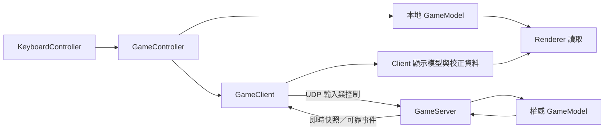

# HaiKyuu 專案架構

本文件記錄實際架構與重構前的缺口，不授權重構或修復。協作與設計規範以 [AGENTS.md](AGENTS.md) 為權威；啟動、使用與發布方式引用 [README.md](README.md)。

盤點日期：2026-11-06。來源為 `refactor` 分支、commit `33b042761e2194dba6a4dbe1a8ff98f264708d7b`；盤點開始時 `AGENTS.md` 已在暫存區。本次只新增／修改文件，沒有變更 Java、素材或建置腳本。此來源識別是現況證據，不代表已選定重構的行為基準。

標記沿用 AGENTS：**A** 已確認需求／限制、**B** 既有規格、**C** 程式或實測觀察、**D** 推導／假設、**E** 待決事項。本文未標示其他分類的實作描述均為 C；現況不等於正確需求，也不表示已通過驗收。

## 1. 系統目的與範圍

- 本地 Java 2D 排球遊戲，提供本地雙人、左右練習、建立房間及加入房間；對應 `Main.main()`、`view.LauncherPanel` 與 README。
- 每隊有 Back、Setter、MB、WS，組裝於 `model.player.Team`；角色控制與規則不是 Web 請求處理。
- 左右練習由 `GameModel(practiceMode, practiceRedServing)` 表示模式差異，`RallyScorer` 與 `ServeHandler` 處理不計分及固定發球方；不是另一套遊戲實作。
- 連線是區網內一個 UDP Server 與兩個 Client。GUI 房主在同一程序建立 Server 和自己的 Client；訪客在其他程序連入。
- 執行依賴桌面環境、鍵盤、圖片素材及 UDP 網路；打包後附帶 Java runtime。沒有雲端帳號、配對服務、HTTP API、資料庫或遊戲存檔流程。
- A：Server 權威與本地／網路共用規則等限制，依 [AGENTS §7](AGENTS.md#7-本地練習與-udp-同步)；本文件不另定義玩法。

## 2. 技術與執行環境

| 項目 | 查驗結果與來源 |
| --- | --- |
| Java | 本次 `java --version`、`javac -version`、`jpackage --version` 均為 21.0.10，退出碼 0。未查到正式指定最低／最高支援 JDK 的設定。 |
| GUI | `javax.swing` 與 `java.awt`，入口是 `Main`、`GamePanel`；未使用 Spring MVC 或其他 MVC 框架。 |
| 建置 | `javac`、`jar`、`jpackage`；未發現 Maven／Gradle 建置檔或 Java module descriptor。 |
| 依賴 | 正式程式使用 JDK API 與專案內類別；圖片載入由 `AssetLoader` 處理。未發現第三方 Java 依賴管理設定。 |
| 測試 | 四個具 `main` 的 Java 測試程式；目前不是 JUnit 或其他測試框架。 |
| 網路 | `DatagramSocket`、自訂二進位 `UdpCodec`、`NetworkStateCodec`。連接埠與協定版本由各自程式常數定義。 |
| 狀態儲存 | 對局與角色狀態在記憶體；沒有 Entity、Repository、ORM、migration、資料庫交易或瀏覽器 Session。 |
| 發行 | `build-release.bat` 呼叫 PowerShell 腳本，建立含 runtime 的 Windows app-image 與版本 ZIP；`Start Haikyuu.vbs` 啟動既有 EXE。 |
| JDK 尋找 | `tools/build-release.ps1::Find-JdkBin()` 依 `JAVA_HOME`、PATH 及安裝目錄找完整工具組，未固定工具鏈版本；本機命令不在 PATH 時需使用實際 JDK 路徑。 |
| CI | 未發現 `.github/workflows` 或其他已登記的 CI 執行入口。這不等於已禁止未來建立 CI。 |

實際使用與建置命令引用 [README 開發者啟動](README.md#開發者啟動)，測試入口引用 [AGENTS §9](AGENTS.md#9-驗證入口與測試原則)，不在本文複製第二套指令。

E：正式支援的 JDK 範圍、發布工具鏈及重構基準版本，要在後續重構計畫確認；本次能執行 JDK 21 不構成產品支援承諾。

## 3. 架構風格與依賴方向

這是以 MVC 分工為基礎、依遊戲功能拆分模型的桌面程式；不是所有狀態都已封裝，也不是純函數模型。

目前可見的主要依賴：

```text
Main → controller、model、network、view
controller → model、network、view.DebugSettings
network → model
view → model、network.NetworkView／NetworkAddress／TimingDiagnostics
model 子模組 → model 與其他必要的 model 子模組
```

- 本次 import 搜尋未發現 `model` 直接匯入 `view`、`controller` 或 `network`；尚未有自動架構測試保證這件事。
- `GameController` 對 `DebugSettings` 的參照是目前除錯顯示切換的直接依賴；`LauncherPanel` 也直接使用 `NetworkAddress` 驗證 IP。這些是現況，不是新核准的架構例外。
- `model.ball.NetHitBox` 使用 AWT 幾何型別建立 Shape；模型不因此建立 Swing 視窗。
- A：允許／禁止的依賴及共用邏輯歸屬，以 [AGENTS §3](AGENTS.md#3-專案職責與依賴) 為準。E：是否抽離目前 View 的網路工具依賴，待重構要求確認。

## 4. 各層責任與實際入口

下表是現況呼叫點索引；規範上的「負責／不負責什麼」及允許依賴，以 AGENTS §3 為唯一完整定義。

| 模組 | 代表性類別／入口 | 目前資料與呼叫關係 |
| --- | --- | --- |
| 組裝 | [Main](Main.java)：`main`、`showLauncher`、`startLocalGame`、`startHostedGame`、`startClient`、`showWindow` | 建立模型、控制器、Client／Server、視窗與關閉監聽。 |
| 輸入與調度 | [KeyboardController](controller/KeyboardController.java)：`getRedInput/getBlueInput`；[GameController.update](controller/GameController.java) | 產生 `TeamInput`，送往 `GameModel.update` 或 `GameClient.update`。 |
| 模型總入口 | [GameModel](model/GameModel.java)：`update`、`updateForNetworkPrediction`、`restart` | 持有球、隊伍、回合與特效，編排更新及同步欄位。 |
| 角色 | [Team.update](model/player/Team.java)、[Player](model/player/Player.java) 與四種角色、`DiveController`、`PlayerActionAnimator`、`PlayerAnimation` | 動作、物理及動畫互相協作；角色持有碰撞箱。 |
| 物理 | [Ball](model/ball/Ball.java)：`update/collideWithNet`；[PhysicsUtils](model/ball/PhysicsUtils.java)、各 HitBox | 更新球、反彈及幾何判定。部分球路計算仍在 `RallyContactHandler` 與 `ServeBallController`。 |
| 回合 | [RallyContactHandler](model/rally/RallyContactHandler.java)、[RallyState](model/rally/RallyState.java)、[RallyScorer](model/rally/RallyScorer.java)、`ScoringLogic` | 碰球、球路、動畫觸發、計次與判分；職責尚有交疊。 |
| 發球 | [ServeHandler](model/serve/ServeHandler.java)、[ServeBallController](model/serve/ServeBallController.java)、`ServeContactPolicy`、`ServeInputLocker` | 發球階段、擺球、出球、輸入過濾與碰撞許可。 |
| 傳輸與同步 | [GameServer](network/GameServer.java)、[ServerPlayerSlot](network/ServerPlayerSlot.java)、[GameClient](network/GameClient.java)、[Packet](network/Packet.java)、[UdpCodec](network/UdpCodec.java)、`NetworkStateCodec` | 接收輸入、權威 tick、序列化、可靠事件、即時快照與 Client 套用。 |
| 畫面校正 | [RemotePlayerInterpolator](network/RemotePlayerInterpolator.java)、[PlayerRenderCorrection](network/PlayerRenderCorrection.java)、`NetworkView` | 對手圖片插值／有限外推、本機圖片位置校正及 View 讀取入口。 |
| 繪圖 | [GamePanel.paintComponent](view/GamePanel.java)、[GameRenderer](view/GameRenderer.java)、各 Renderer、[MatchDisplay](view/MatchDisplay.java) | 讀取模型／NetworkView 畫場地、角色、球、特效與判決。 |
| 素材與診斷 | [AssetLoader.get](view/AssetLoader.java)、[TimingDiagnostics](network/TimingDiagnostics.java) | 圖片快取、背景寫入診斷；不是遊戲存檔或資料庫層。 |

## 5. 模組、目錄與設定組裝

- 原始碼位於根目錄 `Main.java` 與 `controller/`、`model/`、`network/`、`view/`；功能子目錄與責任見 §4，未使用多模組建置。
- 測試位於 `tests/`；其中 `NetworkSyncTest` 宣告 `package network` 以驗證 package 內部協作，其餘測試目前位於未命名 package。
- 素材位於 `assets/images/`；`AssetLoader` 優先讀取 JAR 資源，再回退到外部素材目錄。圖片檔名目前也參與部分動畫／碰撞階段判定，屬待整理差距。
- `GameConfig` 保存全域玩法參數，`Team.setupHitBoxes()` 保存隊伍角色碰撞框配置，Renderer 保存外觀常數；數值權威是這些程式，不是本文。
- `model.AppVersion.LABEL` 是顯示與發行版本來源；`UdpCodec.VERSION` 是另一個用途的線上協定版本，兩者不可混為同一概念。
- `Main` 是主要依賴組裝處；模型與角色建構子也會自行建立協作者，目前沒有依賴注入框架。
- `build/`、`.release-build/`、`release/`、`diagnostics/` 由 `.gitignore` 排除。來源、執行輸出與發行產物不是同一份內容。
- 目前沒有 `shared/common` 模組。是否抽出共用元件，依 AGENTS 的實際用途與歸屬原則判斷，不能只按名稱搬移。

## 6. 主要資料與呼叫流程

### 6.1 本地與練習模式

`Main.startLocalGame()` 組裝新 `GameModel`、`KeyboardController`、`GameController` 與 `GamePanel`。遊戲迴圈每 tick 呼叫 Controller，取得左右 `TeamInput` 後執行模型；Swing EDT 另在重繪時讀取該模型。

目前 `GameModel.updateActiveFrame()` 的順序為：

1. 過濾跨鎖定階段的按鍵，處理發球前置流程及角色所需的規則資訊。
2. 更新兩隊角色，嘗試空中舉球，保存本幀攻擊框的球重疊結果。
3. 處理跳發擊球，更新球／網子碰撞，並檢查過網重設。
4. 未由空中舉球處理時，依紅隊、藍隊順序執行允許的球員碰撞；隊內先查攻擊，再逐一查攔網／一般框。
5. 處理落地；本幀已有角色碰球可取消此次落地判決。
6. 結束發球幀旗標，更新特效與暫時訊息。

上述是時序觀察，不代表每個優先順序都已確認為正式需求。E：重構是否更改同幀衝突處理，需在行為案例中確認；單純搬動呼叫不能假設不影響玩法。

本輪處理方式：保留目前同幀多重碰撞的優先順序，以行為案例防止重構意外改序；公平性調整另議。只有多個碰撞同時成立時，先後處理才可能改變結果，不能單憑「紅隊先處理」就宣稱目前一定不公平，或反過來宣稱已證明公平。

### 6.2 網路輸入、權威更新與畫面



- GUI 房主啟動 Server 執行緒，再以 `GameClient` 連入其區網 IP；並未共用 Server 模型作為自身遊戲畫面。
- `GameClient.update()` 先排空接收資料，處理控制、送出輸入，再執行本機角色預測與圖片校正。藍方視角在 `toWorldInput()` 轉換。
- `GameServer.updateOneTick()` 從 `ServerPlayerSlot` 取得輸入，呼叫同一個 `GameModel.update()`，比較變化後傳送可靠事件，再送即時 `WorldSnapshot`。
- 接收執行緒將 Client 即時快照保留最新一份，其餘訊息排隊；`drainIncoming()` 在遊戲更新執行緒套用。`ReliableEventInbox` 與 `WorldSnapshotInbox` 分別處理事件順序及快照過期判斷。
- `applyOrderedEvent()` 套用完整判決狀態、確認落地煙霧，必要時恢復較新的世界位置；`applyWorldSnapshot()` 更新球、角色、觸球狀態與純視覺旗標。
- 對手畫面由快照插值；MB 的圖片目前有直接採權威狀態的特例，見 `GameClient.getRenderedPlayerAsset()`。本機角色使用 `PlayerRenderCorrection`；除錯碰撞框仍讀物理位置。

### 6.3 得分、重設與退出

- `RallyScorer` 處理判決、死球與下一次發球；`MatchDisplay` 根據模型顯示原因及賽末結果。確切玩法與時間不在本文重複定義。
- 本地 `GameController` 收到重開操作呼叫 `GameModel.restart()`；網路由 `ServerPlayerSlot` 排序控制，`GameServer.processControls()` 在雙方確認後呼叫 restart，發送可靠 RESET。
- `restart()` 除呼叫 `GameResetter.reset()`，還清除 scorer、觸球、特效、預測及輸入保護狀態；僅呼叫其中一個 reset 不等於完整重開。
- `Main.showWindow()` 的 `windowClosing` 停止 GamePanel 迴圈並關閉 Client／房主 Server；目前關閉遊戲不會重新顯示選單。
- 連線／確認逾時與中止由 Client、Server 分別處理，透過 `NetworkStatusRenderer` 顯示。關閉分支仍有已知差距，見 §11；不得把這段描述解讀成資源清理已經完整。

## 7. 資料模型與邊界

| 資料 | 現況用途與跨界方式 |
| --- | --- |
| `TeamInput` | 同時保存按鍵及本機每幀推導資訊；`Packet.encodeInput/decodeInput` 只傳指定輸入位元，不傳 Ball／Player 參照。 |
| `GameModel`、`RallyState`、`ServeHandler` | 記憶體中的世界／回合／發球狀態。GameModel 的公開計數與 RallyState 有重複來源，尚未完成封裝。 |
| `Player`、`Ball`、HitBox | 可變的物理、角色與碰撞資料；Player 同時持有圖片與動畫狀態。球心／圖片左上角等座標約定依 AGENTS §5。 |
| `Packet.*State` | 擷取及還原球、隊伍、觸球與回合狀態；`CompactState` 與 `WorldSnapshot` 用途不同。部分快照欄位仍可變，不能聲稱已是不可變畫面快照。 |
| `UdpCodec.Decoded` | 解碼後的傳輸訊息；由 GameClient／GameServer 辨識類型，再交內部狀態處理。 |
| 校正／插值 Sample | 僅供圖片位置、方向與素材顯示，不作權威碰撞輸入。 |
| `SpikeEffect`／`EffectManager` | 軌跡、煙霧及舊圖片特效清單；目前直接暴露可變清單給 Renderer。 |

`Packet.encodeNullableBoolean/decodeNullableBoolean` 轉換未定隊伍的 null；`NetworkStateCodec` 負責可空字串與欄位序列。部分無效列舉值會被替換成預設動作／狀態，不能推定所有無效資料都已嚴格拒絕。詳細欄位順序以 codec 為準，不在文件維護第二份欄位清單。

E：原始輸入／規則上下文的拆分、狀態唯一來源及不可變畫面資料的型別與 API，尚未核准設計。

## 8. 狀態、執行緒與資源生命週期

本專案沒有資料庫交易或 rollback；這裡的「狀態一致性」指遊戲 tick、封包及畫面資料，不能套用資料庫交易假設。

| 執行環境 | 目前工作與資料接觸 | 已知界線 |
| --- | --- | --- |
| Swing EDT | 視窗、鍵盤事件、`paintComponent`；讀取模型與特效。 | 與遊戲更新共用可變資料，尚無整幀一致快照。 |
| GamePanel 遊戲執行緒 | 本地模型更新，或 GameClient 收包套用／自身預測；要求重繪。 | `stopGameLoop()` 中斷執行緒，但沒有等待退出完成的驗收。 |
| Server 主迴圈 | 權威模型 tick、處理控制、產生事件與世界快照。 | 關閉採中止流程；未預期例外後的 socket 清理仍需核對。 |
| Server 接收執行緒 | 接收輸入、ACK、控制及 HELLO，更新玩家席位；HELLO 回覆會讀取模型產生 WELCOME。 | 後者可能與主迴圈同時讀寫模型；非所有跨執行緒資料都已有一致快照。 |
| Client 接收執行緒 | 接收封包，寫入 concurrent queue／最新快照 AtomicReference。 | 正常資料由遊戲更新執行緒套用；不是直接在此更新角色物理。 |
| 重送排程器 | Client 控制重送、Server 事件重送與期限檢查。 | 與主流程共用連線及中止狀態，需維持順序與資源清理。 |
| 診斷執行緒 | `TimingDiagnostics` 背景寫入有界佇列中的訊息。 | 靜態、程序共用且使用 daemon；不是每場對局各自建立的服務。 |

目前 `RallyState`、`ServeState`、`PlayerAction` 及多個旗標共同表示狀態；對局重開與關閉不是同一個生命週期。A：資料所有權、同步、關閉及效能驗收的規範依 AGENTS §2、§6、§8。E：具體執行緒模型、快照發布方式、補跑策略及資源關閉期限，須在重構計畫一起確認。

## 9. 錯誤、輸入與診斷邊界

- `LauncherPanel` 在加入房間前驗證 IPv4；`NetworkAddress` 選擇／檢查可分享的區網地址，`Main` 將啟動例外轉成使用者訊息。
- 網路封包先由 codec 檢查標頭／協定版本；Server 再依 session token、地址與 port 對應玩家。這是對局識別，不是帳號認證、TLS 或功能授權系統。
- 回合內的犯規／得分由模型判斷並轉為狀態與可靠事件；網路技術失敗由連線中止訊息呈現，不應混成比賽得分。
- `UdpCodec.decode()` 對無法解碼的資料回傳 null；部分列舉值另有預設替代。`AssetLoader` 載入失敗會回傳 null，部分 Renderer 有替代畫法，球圖片失敗則不畫球。
- `TimingDiagnostics` 記錄慢更新、繪圖、接球事件與快照中斷；視窗／連線錯誤另有顯示。此處只記責任入口，記錄內容限制依 AGENTS §8。
- C：未看到登入、資料擁有權或持久化機制；不建立對應的空架構層。E：初始化失敗、未知例外與可預期封包丟棄的完整處理政策待重構確認。

## 10. 架構驗證與本次證據

本表 ID 僅識別驗證項；規則全文引用 AGENTS，不在此另定義。檢查存在、接入入口與本次通過是不同狀態。

| ID／權威來源 | 現有驗證 | 建置／CI 狀態 | 本次狀態 |
| --- | --- | --- | --- |
| ARC-DEP／AGENTS §3 | 目前僅 import 與呼叫鏈人工檢查，沒有完整依賴／循環防護。 | 未接入自動建置；未發現 CI。 | 已查直接 import；不能聲稱完整架構檢查通過。 |
| GAME-FLOW／AGENTS §5–6 | `GameplayFlowTest` 的碰撞、計次、按鍵、模式與階段案例。 | 打包腳本會編譯並執行。 | 本次文件工作未重跑。 |
| NET-ORDER／AGENTS §7 | `NetworkSyncTest` 的 codec 往返、順序、快照及特效確認案例；基本模式亦會建立真實 Client。 | 基本模式接入打包；`loopback` 是額外選項，兩者皆須避免干擾現行 Server。 | 本次未重跑；測試傳輸隔離缺口列於 AGENTS §11，不宣稱雙機區網實測。 |
| THREAD-LIFECYCLE／AGENTS §8 | 尚無完整競爭、長時間執行與關閉資源驗收。 | 尚未形成自動防護。 | 已核對程式與既有缺口，未執行壓力／資源測試。 |
| UI-ENTRY／AGENTS §9 | `LauncherTest` 在 EDT 驗證選單操作與輸入。 | 接入打包腳本。 | 本次未重跑；不等同實體視窗驗收。 |
| RELEASE-ASSET／AGENTS §10 | `PackagingSmokeTest`、JAR 素材清單及 ZIP 必要檔案檢查。 | 接入 `build-release.bat` 呼叫的腳本。 | 未重新打包或更新 EXE／ZIP。 |
| TOOLCHAIN／AGENTS §9–10 | `java --version`、`javac -version`、`jpackage --version`。 | 建置未鎖定版本。 | 本次用完整工具路徑執行，三者均為 21.0.10，退出碼 0；PATH 沒有解析到這些工具。 |

本次證據為來源檔、入口搜尋及工具版本查驗；沒有以歷史測試成功代替本次驗證。文件完成後的格式／連結檢查另於交付說明記錄。

## 11. 已知差距、已確認限制與待決事項

**已確認限制（A）**：保留 AGENTS 登記的職責方向、座標、Server 權威及操作界線；沒有核准改用 ECS／MVVM、Web 架構、不同建置工具或新持久層。

**已確認範圍（A）**：使用者要求將前次與補查缺陷一併列入後續重構／修復；清單以 AGENTS §11 為準。保留同幀碰撞優先順序，公平性調整暫緩；具體實作批次與驗收計畫仍依 AGENTS §2 確認。

**現況差距（C／D）**：完整待辦只有 [AGENTS §11](AGENTS.md#11-已知審查待辦不得當成已修復或合理-baseline) 一份。本文 §4、§7、§8 記錄涉及的責任與資料流，沒有修復這些問題；歷史重現結論若用於新批次，仍應依目前來源驗證。

**尚待確認（E）**：

1. 已列入範圍的具體目標、批次邊界、依賴與完成條件。
2. 可比較的來源基準、模式／角色／左右側驗證矩陣與不可改變的行為；同幀優先順序先按現況刻畫，不在本輪調整。
3. 執行緒及狀態所有權的目標設計、公開 API 與過渡方式；目前只有規範，尚無核准的具體類別重組。
4. 固定時鐘、亂數種子、輸入重播與網路延遲模擬的測試方式；現況 `ServeBallController` 自行建立 Random，未見統一的可重現模擬入口。
5. JDK 支援範圍、乾淨建置、防護接入方式，以及是否建立 CI。
6. 效能比較場景、允許退化範圍、關閉資源期限、人工實測分工與批次回復方式。

下一步由使用者提出重構要求，再依 AGENTS §2 形成可審閱的批次與驗證計畫。這份架構盤點完成，不代表上述待決設計或全專案實作已核准；目前不新增 ADR 或重構任務文件來預先決定答案。
